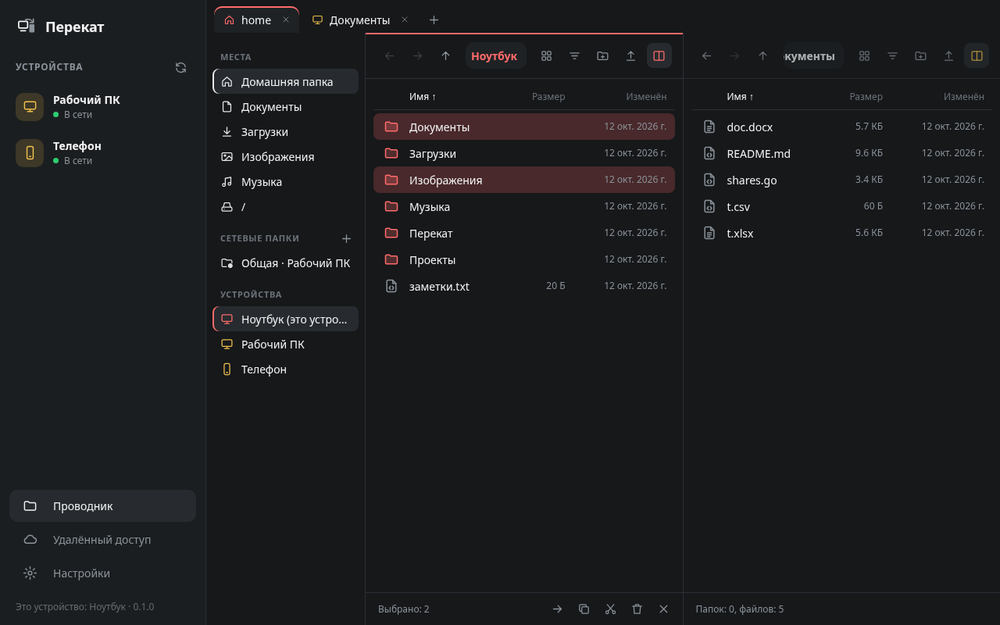
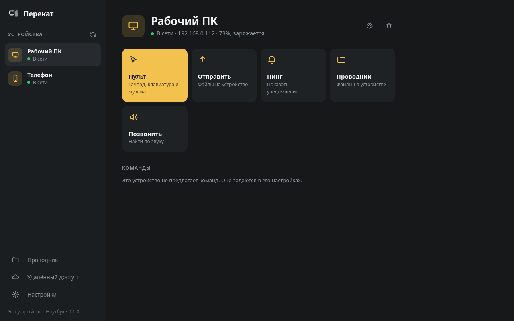
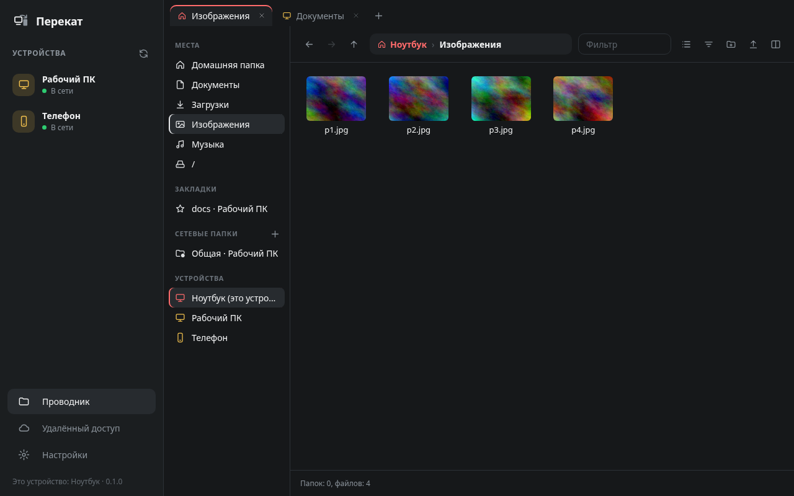
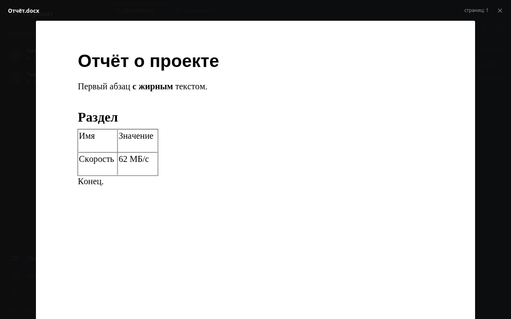
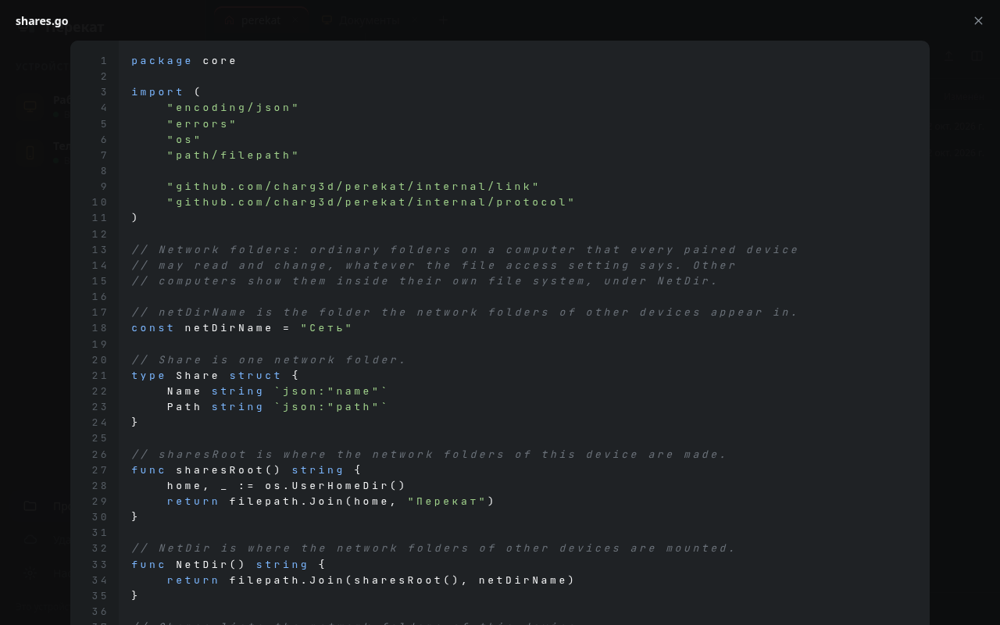
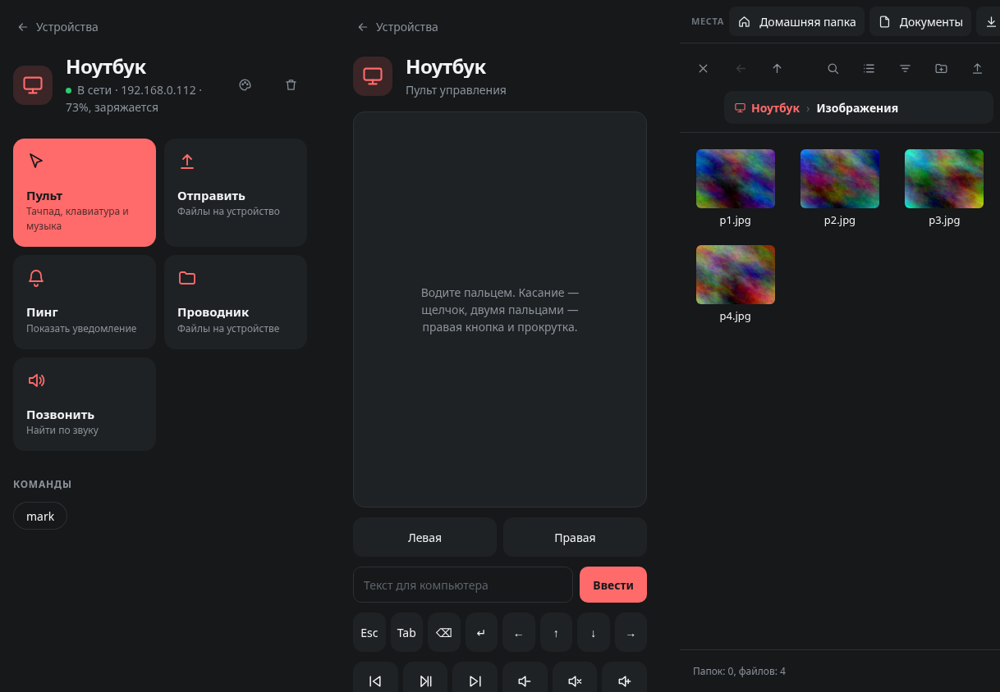

<div align="center">

# Перекат

**Свои устройства как одно рабочее место.**
Общий буфер обмена, файлы, проводник по всем устройствам, сетевые папки, пульт и уведомления — между Linux, Windows и Android, без облака и аккаунтов.




<sub>Скриншоты сделаны на демо-данных.</sub>

</div>

---

## О проекте

Перекат связывает компьютеры и телефоны одного человека. Устройства находят друг друга в локальной сети, один раз сопрягаются по коду и дальше работают вместе: скопировал на одном — вставил на другом, открыл на ноутбуке папку телефона, поделился фото с телефона прямо на компьютер.

Если поставить свой сервер-ретранслятор на VPS, всё то же самое работает из любой точки мира. Данные между устройствами зашифрованы на всём пути: сервер видит только поток байтов.

Проект написан на Go. В основе — протокол KDE Connect (обнаружение, TLS, сопряжение), поверх которого добавлены собственные пакеты. Совместимость с KDE Connect сохранена и включается в настройках.

## Возможности

| | |
|---|---|
| **Буфер обмена** | Текст синхронизируется между всеми сопряжёнными устройствами. Скриншот, скопированный на одном компьютере, попадает в буфер другого. Записи менеджеров паролей не передаются. |
| **Проводник** | Файлы любого устройства в одном окне: вкладки, две панели, список и значки с миниатюрами, поиск, закладки, свойства, zip. Копирование и перенос между устройствами, перетаскивание. |
| **Просмотр** | Картинки, PDF, офисные документы (docx, pptx, xlsx, odt…), код с подсветкой, Markdown, архивы — не скачивая файл. |
| **Сетевые папки** | Обычная папка на компьютере, которую видят и могут менять все устройства. На Linux чужие сетевые папки монтируются в `~/Перекат/Сеть` и работают в любой программе. |
| **Удалённый доступ** | Свой сервер на VPS ставится из окна по адресу и паролю; остальные устройства подключаются кодом. |
| **Пульт** | Мышь одного компьютера управляет другим. Телефон работает как тачпад, клавиатура и пульт для музыки. |
| **Телефон** | «Поделиться» в любом приложении, плитка в шторке, уведомления телефона на компьютере, заряд батареи, «найти устройство». |
| **Команды** | Свой список команд, которые можно запускать с других устройств. |

<div align="center">
 
 


</div>

## Установка

Готовые сборки лежат на странице [релизов](../../releases).

**Linux.** Распакуйте архив и запустите `./install.sh`: программы попадут в `~/.local/bin`, значок — в список приложений. Нужны `webkit2gtk-4.1`, `wl-clipboard` и `fuse3`; для пульта пользователь должен входить в группу `input`. Для просмотра офисных документов — LibreOffice, для миниатюр PDF и видео — `poppler` и `ffmpeg`, для ввода текста с телефона — `wtype`.

**Windows.** Распакуйте архив и запустите `perekat-gui.exe`.

**Android** (8.0 и новее, arm64). Установите APK, разрешите уведомления и доступ к файлам.

Дальше на любом из устройств откройте второе в списке, нажмите «Сопрячь» и подтвердите код на втором.

## Удалённый доступ

В разделе «Удалённый доступ» введите адрес VPS, логин и пароль SSH. Перекат сам поставит на сервер ретранслятор как службу systemd и покажет код. На остальных устройствах достаточно вставить этот код. Ретранслятор слушает один порт (17160), работает без прав администратора и не трогает то, что уже стоит на сервере.

## Консоль

```
perekat daemon                 работать в фоне без окна
perekat devices                устройства
perekat pair <устройство>      сопрячь или принять запрос
perekat send <устройство> <файл>...
perekat run <устройство> [команда]
perekat remote <устройство>    мышь этого компьютера управляет тем
perekat relay                  состояние удалённого доступа и код
perekat version
perekat-gui -open <путь>       открыть файл или папку в проводнике
perekat-gui -hidden            запуститься без окна, в трее
```

## Как это устроено

```
cmd/perekat          консоль и демон
cmd/perekat-gui      окно (Wails), запускает демон внутри себя, если его нет
cmd/perekat-relay    сервер-ретранслятор для удалённого доступа
internal/core        устройства, сопряжение, буфер, файлы, сетевые папки, просмотр
internal/link        шифрованная связь и передача файлов
internal/discovery   поиск устройств в локальной сети
internal/relay       протокол ретранслятора
internal/netfs       сетевые папки как файловая система (FUSE)
internal/ui          интерфейс: один и тот же в окне и на телефоне
android/             приложение для Android вокруг того же демона
```

Демон — одна программа на всех системах. Окно и телефон показывают один и тот же интерфейс; на телефоне он открыт в WebView, а демон работает рядом как обычный процесс.

## Сборка

Нужен Go 1.27. Для окна на Linux — `webkit2gtk-4.1`, для Android — Android SDK (build-tools и платформа; NDK и Gradle не нужны).

```
make            # bin/perekat и bin/perekat-gui
make windows    # bin/*.exe
make android    # bin/perekat.apk
make install    # в ~/.local и в список приложений
make test
make dist VERSION=0.1.0   # архивы релиза в dist/
```

## Ограничения

- Сборка для Windows входит в выпуск, но на настоящей Windows ещё не проверялась.
- Сетевые папки монтируются в систему только на Linux; на Windows и телефоне они доступны в проводнике Переката.
- Телефоном нельзя управлять с компьютера, и буфер с телефона уходит только пока приложение на экране или по плитке «Буфер → устройства»: так устроен Android.
- Клавиатура в режиме пульта между компьютерами пока не передаётся, только мышь.
- Картинки в буфере обмена работают между компьютерами с Linux.

## Лицензия

MIT. Сторонние компоненты перечислены в [THIRD_PARTY.md](THIRD_PARTY.md).
