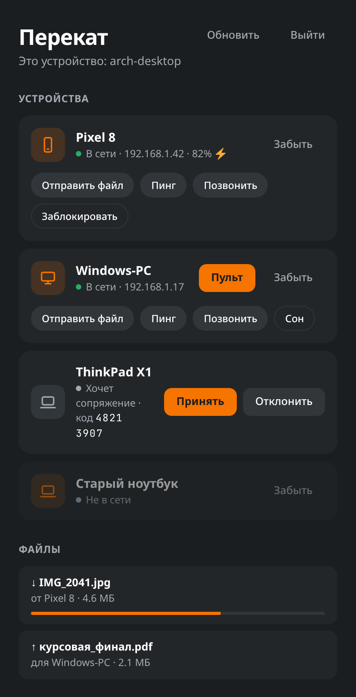
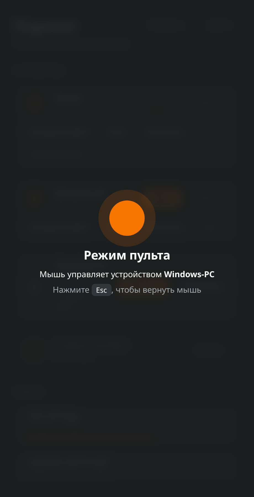

<div align="center">

# Перекат

**Один мост между Arch Linux и Windows в локальной сети.**
Общий буфер обмена, передача файлов, удалённая мышь и запуск команд — без облака и аккаунтов.




<sub>Окно приложения. Скриншот сделан на демо-данных.</sub>

</div>

---

## О проекте

Рабочее место разделено между Linux-машиной и Windows-компьютером, а переносить текст и файлы приходится через мессенджер «самому себе». **Перекат** убирает этот шаг: оба устройства находят друг друга в локальной сети, один раз сопрягаются и дальше работают как одно рабочее место.

Протокол — **KDE Connect (версия 8)**, поэтому Перекат говорит на языке устройств, которые уже его используют, и дополняет его своим расширением для общей мыши.

Весь проект — на Go, без внешних сервисов: данные не покидают локальную сеть.

## Возможности

<table>
  <tr>
    <td width="33%" valign="top">

### 📋 Общий буфер
Скопировали на одной машине — вставили на другой. Если буферы разошлись при подключении, побеждает более свежий.

</td>
    <td width="33%" valign="top">

### 📁 Файлы
Отправка файлов одной командой или кнопкой в окне. Принятые файлы попадают в папку загрузок, прогресс виден в списке.

</td>
    <td width="33%" valign="top">

### 🖱 Режим пульта
Одна мышь управляет двумя компьютерами. Linux читает события напрямую из evdev и вводит их через uinput, Windows — через `SendInput`. Вернуть мышь — `Esc`.

</td>
  </tr>
  <tr>
    <td valign="top">

### ⚙️ Свои команды
Описываете команды в `commands.json` — второе устройство запускает их одной кнопкой: заблокировать экран, усыпить, что угодно.

</td>
    <td valign="top">

### 🔔 Пинг и «найти устройство»
Показать уведомление на другом устройстве или заставить его звонить. Заряд батареи подключённых устройств виден в списке.

</td>
    <td valign="top">

### 🔐 Сопряжение
Самоподписанный сертификат ECDSA P-256 у каждого устройства, TLS и закрепление сертификата при сопряжении. Оба устройства показывают один и тот же код — его нужно сверить.

</td>
  </tr>
</table>

## Скриншоты

<table>
  <tr>
    <td width="50%" align="center"><br><sub><b>Устройства</b> — статус, заряд, быстрые действия, передачи файлов</sub></td>
    <td width="50%" align="center"><br><sub><b>Режим пульта</b> — мышь управляет другим устройством</sub></td>
  </tr>
</table>

## Консоль

То же самое доступно без окна — удобно для скриптов и биндов в композиторе:

```text
$ perekat devices
NAME         TYPE     ADDRESS        STATUS                         ID
Pixel 8      phone    192.168.1.42   paired                         a1…
Windows-PC   desktop  192.168.1.17   paired                         b2…
ThinkPad X1  laptop   192.168.1.23   wants to pair, key 4821 3907   c3…

$ perekat pair "ThinkPad X1"
$ perekat send Windows-PC report.pdf photo.jpg
$ perekat remote Windows-PC          # мышь переходит на Windows-PC
$ perekat run Pixel\ 8 lock
$ perekat ping Pixel\ 8
```

| Команда | Что делает |
|---|---|
| `perekat daemon [-v]` | запускает демон: ищет устройства и держит соединения |
| `perekat devices` · `refresh` | список устройств · поиск заново |
| `perekat pair` · `unpair <устройство>` | сопрячь / забыть (или принять / отклонить запрос) |
| `perekat send <устройство> <файл>…` | отправить файлы |
| `perekat remote <устройство>` · `remote off` | включить / выключить режим пульта |
| `perekat run <устройство> [команда]` | запустить команду на устройстве или показать список |
| `perekat commands` | файл с командами, которые предлагает эта машина |
| `perekat ping` · `ring <устройство>` | уведомление · звуковой сигнал |

## Как это устроено

```text
   ┌────────────────────── perekat daemon ───────────────────────┐
   │                                                             │
   │   discovery ──► link ──► core ──► features                  │
   │   UDP-broadcast   TLS    протокол   буфер · файлы ·         │
   │   порт 1716      сессия  и сопряж.  команды · пинг · мышь   │
   │                              │                              │
   │                       trust (paired.json)                   │
   └──────────────────────────────┬──────────────────────────────┘
                                  │ локальный сокет (HTTP)
                    ┌─────────────┴─────────────┐
                    ▼                           ▼
              perekat (CLI)            perekat-gui (Wails)
```

| Пакет | Назначение |
|---|---|
| `internal/protocol` | формат пакетов KDE Connect v8, возможности устройства |
| `internal/discovery` | поиск по UDP-broadcast; объявляется при старте, входе в сеть и по запросу, а не по таймеру — чужие реализации переподключаются на каждое объявление |
| `internal/link` | TLS-соединение и передача payload по отдельному порту |
| `internal/identity`, `internal/trust` | идентичность устройства, сертификат, список сопряжённых |
| `internal/core` | сопряжение, буфер, передача файлов, команды, пульт |
| `internal/input` | захват и ввод мыши: evdev + uinput (Linux), `SendInput` (Windows) |
| `internal/clipboard`, `internal/desktop` | буфер (`wl-paste` / Win32) и уведомления |
| `internal/ipc` | локальный API между демоном, CLI и окном |
| `cmd/perekat-gui` | окно на Wails с лёгким фронтендом без фреймворков |

Решения, которые стоит отметить:

- **Окно не требует отдельного демона.** Оно подключается к уже работающему, а если его нет — запускает свой внутри процесса.
- **Только локально.** Никаких серверов, регистрации и телеметрии.
- **Один источник правды.** CLI и окно ходят в одно и то же локальное API.
- **Linux и Windows из одной кодовой базы.** Системные различия спрятаны за build-тегами внутри пакетов `input`, `clipboard`, `desktop`.

## Сборка

Нужен Go. Для окна на Linux — `webkit2gtk-4.1`; для буфера на Linux — `wl-clipboard`.

```bash
make cli        # bin/perekat
make gui        # bin/perekat-gui
make windows    # perekat.exe и perekat-gui.exe
make test       # go vet и go test
```

Режиму пульта на Linux нужен доступ к `/dev/uinput` и evdev: достаточно членства в группе `input`.

## Лицензия

MIT — см. [LICENSE](LICENSE). Автор — **Дмитрий Фастовец** ([@charg3d](https://github.com/charg3d)).
